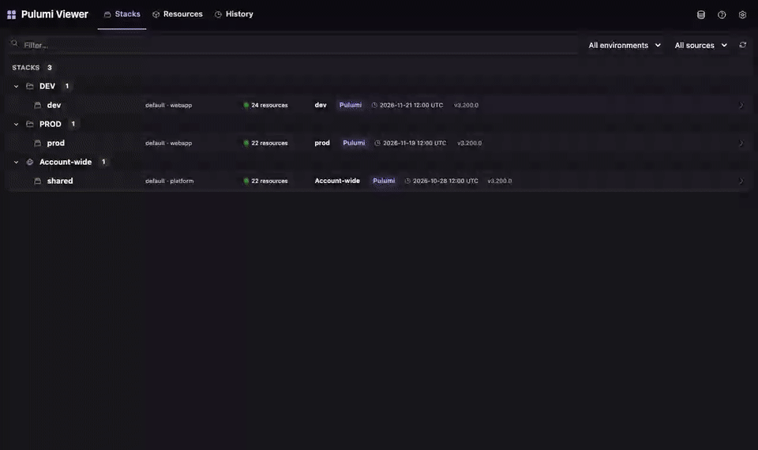
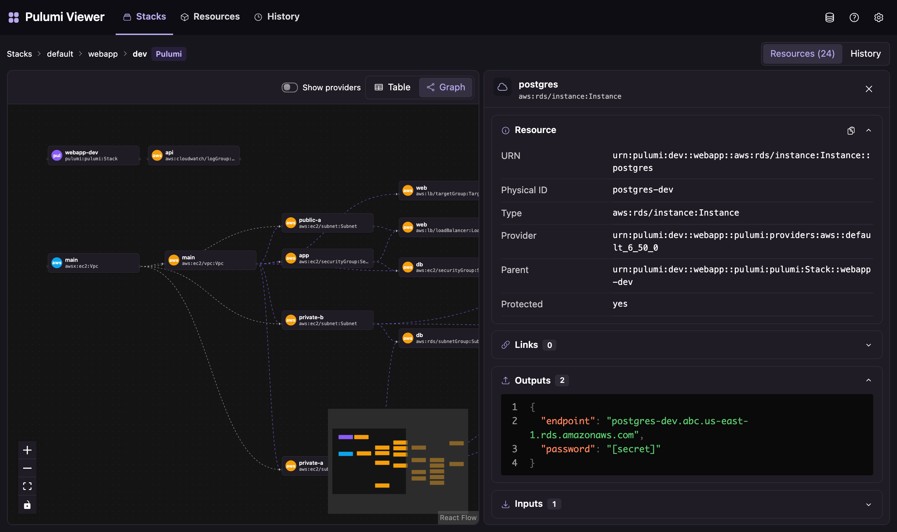
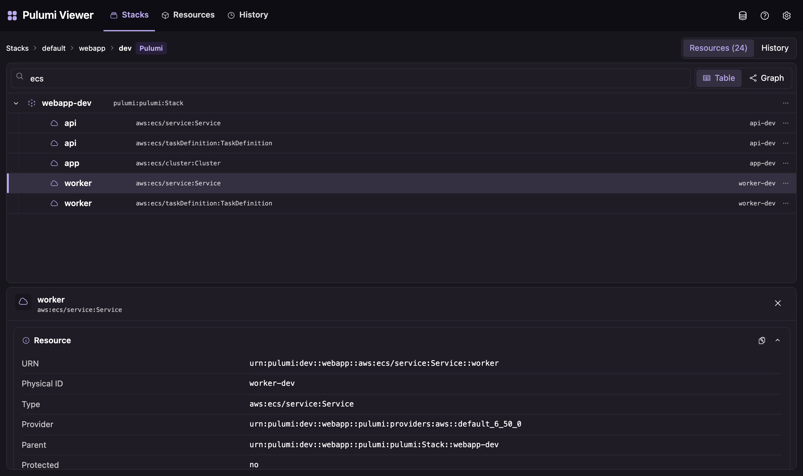
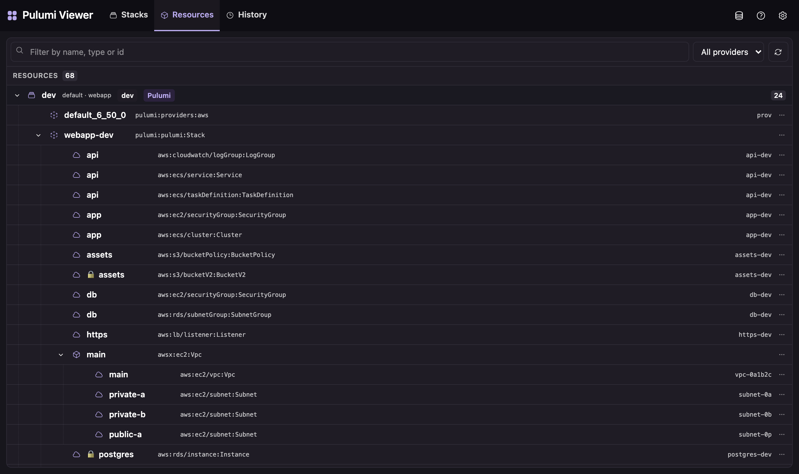
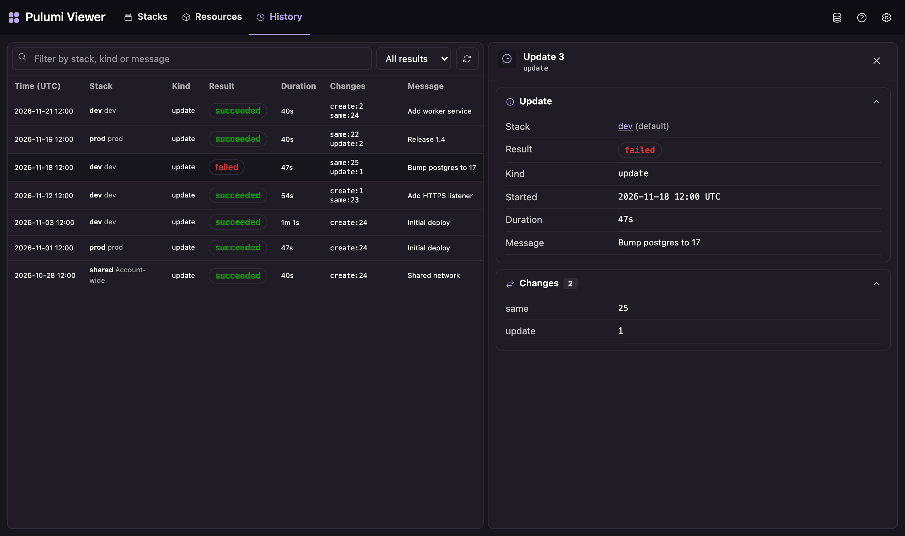
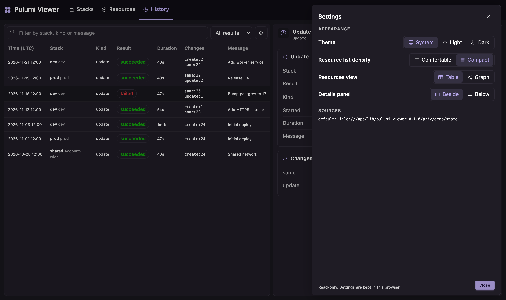

# Pulumi Viewer

**See what Pulumi manages, without Pulumi Cloud.** Pulumi Viewer is a read-only web app for
Pulumi self-managed (DIY) backends: an S3 bucket, a local `file://` folder, or S3 on a local AWS
emulator. Point it at the same URL you use for `pulumi login`.

What you can do with it:

- **Read several sources at once** (`PULUMI_VIEWER_SOURCES`): Pulumi file or S3 state and live CloudFormation side by side. One failing source shows its own error; the others still render.
- **List every stack grouped by environment** (DEV, staging, PROD, then account-wide stacks such as `shared` and `ci`), then by source and project, with a Pulumi or CloudFormation badge, resource count, last update and Pulumi version. Filter by environment and source.
- **Follow the same resource across sources**: a resource with the same physical ID in Pulumi and in CloudFormation links to the other stack.
- **See a stack as a graph**: resources laid out by dependency, with parent and provider links (xyflow + ELK).
- **Open any resource**: URN, physical ID, parent, inputs, outputs and raw JSON, highlighted with the [diffs.com](https://diffs.com) code viewer. Secrets stay encrypted (`[secret]`).
- **Search resources** by name, type or physical ID.
- **Read the update history**: each `pulumi up` with its result, change counts and message.
- **Use real AWS or an emulator** (Floci, LocalStack, AWS Emulator) with the same code.
- **Run it anywhere**: one Docker image, or as a resource in an Aspire AppHost (C#, TypeScript or Go).
- **A familiar dashboard layout**: top tabs (Stacks, Resources, History), tree lists with expand and collapse, a Table / Graph switch and a resizable details panel beside or below the list. The settings (theme, density, first view, panel position) stay in your browser.
- **Stay safe**: it only lists and reads objects. It never writes state or calls `pulumi`.



[Watch the demo video (MP4)](docs/media/demo.mp4)

| Stacks | Resource graph |
| --- | --- |
|  |  |
| **Resource details** | **Search, details below** |
|  |  |
| **All resources** | **Update history** |
|  |  |
| **Settings** | **Light theme** |
|  |  |

## Quick start (Docker)

```sh
docker run --rm -p 4000:4000 ghcr.io/nakamadevs/pulumi-viewer:latest   # demo state at http://localhost:4000
```

Images are multi-arch (amd64, arm64): `latest` is `main`, `sha-<commit>` pins one commit.
To run your own changes, `docker build -t pulumi-viewer .` from a clone.

More Docker samples (real S3, local folder, emulator) and Aspire AppHost samples in
**C#, TypeScript and Go**: [docs/aspire.md](docs/aspire.md).

Built with Elixir, Phoenix LiveView, [Ash](https://ash-hq.org) (state is modelled as Ash resources),
Tailwind/daisyUI, [xyflow](https://xyflow.com) + [ELK](https://eclipse.dev/elk/) for the graph,
[@pierre/diffs](https://diffs.com) for code and (later) preview diffs,
and optional [Tidewave](https://tidewave.ai) in dev.

## Run from source


```sh
mise install && mise run setup
mise run serve                                   # demo state, http://localhost:4077
mise run serve:aws -- my-profile s3://my-pulumi-state
mise run serve:emulator -- s3://my-pulumi-state http://localhost:4566
PULUMI_BACKEND_URL=file://~/.pulumi-state mise run serve
```

The backend URL uses the same form as `pulumi login`. The viewer only lists and reads objects
(`s3:ListBucket`, `s3:GetObject`); it never writes. Secret values stay encrypted and show as `[secret]`.

## What it reads

| Key | Use |
| --- | --- |
| `.pulumi/stacks/<project>/<stack>.json[.gz]` | current checkpoint: resources, parents, dependencies, providers |
| `.pulumi/stacks/<stack>.json[.gz]` | legacy (non project-scoped) stacks |
| `.pulumi/history/<project>/<stack>/*.history.json` | update history |

### Several sources

```sh
PULUMI_VIEWER_SOURCES='pulumi=file:///state/pulumi;cloudformation=cloudformation://us-east-1'
```

Separate the `name=url` entries with a newline, `;` or `,`. A comma inside a query value
(`?prefix=a,b`) stays in its URL. Each URL is `file://`, `s3://` or `cloudformation://`.
`PULUMI_BACKEND_URLS` is the older name of the same setting. `PULUMI_BACKEND_URL` alone still
works (one source named `default`). Stack pages are at `/sources/<source>/stacks/<project>/<stack>`;
`/stacks/<project>/<stack>` reads the first source. A source that fails (for example, expired
credentials) shows its own error, and the others still load.

Each AWS source can use its own profile with `?profile=<name>`, for example
`prod=cloudformation://us-east-1?profile=prod-readonly`. When the `aws` CLI is installed, the
viewer gets the credentials with `aws configure export-credentials`, so every profile type works
(keys, SSO, `aws login`, assumed roles). Without the CLI (for example in the Docker image), ExAws
reads `~/.aws` itself (keys and SSO only). A source with a profile never falls back to other
credentials. A source without a profile uses the credential chain below.

Environment of a stack: for Pulumi the stack name (`dev`, `staging`, `prod`, also
`<env>-<anything>` and `<anything>-<env>`); for CloudFormation the first name token that is
`dev|prod|staging|shared|ci`. `shared`, `ci` and stacks without an environment are account-wide.
Pulumi state is read again on each page load; CloudFormation responses are cached for 60 s.

### CloudFormation source

Infrastructure in CloudFormation, not Pulumi? Set
`PULUMI_BACKEND_URL=cloudformation://<region>` (optionally `?prefix=<stack name prefix>`).
The same pages then show live CloudFormation stacks, read-only:

| Viewer | CloudFormation |
| --- | --- |
| project / stack | stack name before the first `-` / stack name (`ListStacks`, live stacks only) |
| resources | `ListStackResources`; inputs are the `Properties` from `GetTemplate` (JSON or YAML with `!Ref`, `!GetAtt`, `!Sub` ...) |
| graph edges | `Ref`, `Fn::GetAtt`, `Fn::Sub` references and `DependsOn` |
| stack node outputs | stack outputs (`DescribeStacks`) |
| history | `DescribeStackEvents`, one row per stack operation |

It needs only `cloudformation:ListStacks`, `DescribeStacks`, `ListStackResources`,
`DescribeStackEvents` and `GetTemplate`. Responses are cached for 60 s; throttled calls are
retried with backoff. Missing or expired credentials show a clear message.

Tidewave is optional and dev only. Turn it off with `TIDEWAVE=false mise run serve`.

## Screenshots and video

`tools/capture/capture.mjs` (Playwright) takes the screenshots and records the demo, with
assertions on each step. The demo state comes from `priv/demo/generate.py`.

```sh
docker run --rm -d -p 4078:4000 pulumi-viewer
cd tools/capture && npm ci && BASE_URL=http://localhost:4078 node capture.mjs
```

## Layout

- `lib/pulumi_viewer/pulumi/` – pure parsers: key layout, checkpoint, history, graph.
- `lib/pulumi_viewer/storage/` – `Local` and `S3` readers behind one behaviour.
- `lib/pulumi_viewer/infra/` – Ash domain `PulumiViewer.Infra` (`Stack`, `Resource`, `Update`).
- `assets/js/resource_graph.jsx` – xyflow graph, mounted as a LiveView hook.
- `assets/js/code_block.js` – `CodeBlock` hook: any code or JSON panel, rendered with `@pierre/diffs`.

## Roadmap

- Pending changes: render saved `pulumi preview --json` output.
- Drift and coverage: compare Pulumi state with CloudFormation stacks and the live AWS inventory.
- Policy (CrossGuard results) and FinOps (Cost Explorer) views.

Prior art worth reading: [mlops-club/pulumi-ui](https://github.com/mlops-club/pulumi-ui),
[state-db/statedb](https://github.com/state-db/statedb),
[pandada8/pulumi-api-backend](https://github.com/pandada8/pulumi-api-backend).

## License

MIT
