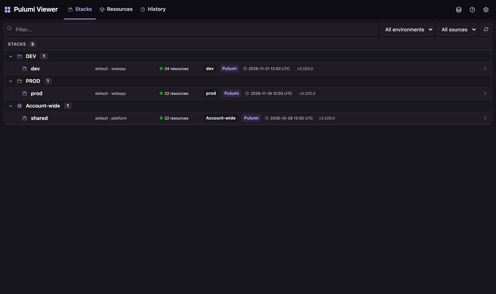
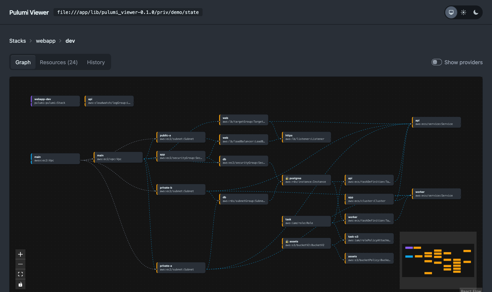
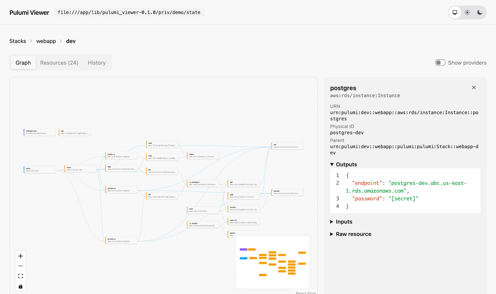

# Pulumi Viewer

**See what Pulumi manages, without Pulumi Cloud.** Pulumi Viewer is a read-only web app for
Pulumi self-managed (DIY) backends: an S3 bucket, a local `file://` folder, or S3 on a local AWS
emulator. Point it at the same URL you use for `pulumi login`.

What you can do with it:

- **List every stack** in a backend, grouped by project, with resource count, last update and Pulumi version.
- **See a stack as a graph**: resources laid out by dependency, with parent and provider links (xyflow + ELK).
- **Open any resource**: URN, physical ID, parent, inputs, outputs and raw JSON, highlighted with the [diffs.com](https://diffs.com) code viewer. Secrets stay encrypted (`[secret]`).
- **Search resources** by name, type or physical ID.
- **Read the update history**: each `pulumi up` with its result, change counts and message.
- **Use real AWS or an emulator** (Floci, LocalStack, AWS Emulator) with the same code.
- **Run it anywhere**: one Docker image, or as a resource in an Aspire AppHost (C#, TypeScript or Go).
- **Stay safe**: it only lists and reads objects. It never writes state or calls `pulumi`.


[Watch the demo video (MP4, 12 s)](docs/media/demo.mp4)

| Stacks | Resource graph |
| --- | --- |
|  |  |
| **Resource details** | **Search** |
|  |  |
| **Update history** | **Light theme** |
|  |  |

## Quick start (Docker)

```sh
docker build -t pulumi-viewer .
docker run --rm -p 4000:4000 pulumi-viewer          # demo state at http://localhost:4000
```

More Docker samples (real S3, local folder, emulator) and Aspire AppHost samples in
**C#, TypeScript and Go**: [docs/aspire.md](docs/aspire.md).

Built with Elixir, Phoenix LiveView, [Ash](https://ash-hq.org) (state is modelled as Ash resources),
Tailwind/daisyUI, [xyflow](https://xyflow.com) + [ELK](https://eclipse.dev/elk/) for the graph,
[@pierre/diffs](https://diffs.com) for code and (later) preview diffs,
and optional [Tidewave](https://tidewave.ai) in dev.

## Run from source


```sh
mise install && mise run setup
mise run serve                                   # demo state, http://localhost:4077
mise run serve:aws -- my-profile s3://my-pulumi-state
mise run serve:emulator -- s3://my-pulumi-state http://localhost:4566
PULUMI_BACKEND_URL=file://~/.pulumi-state mise run serve
```

The backend URL uses the same form as `pulumi login`. The viewer only lists and reads objects
(`s3:ListBucket`, `s3:GetObject`); it never writes. Secret values stay encrypted and show as `[secret]`.

## What it reads

| Key | Use |
| --- | --- |
| `.pulumi/stacks/<project>/<stack>.json[.gz]` | current checkpoint: resources, parents, dependencies, providers |
| `.pulumi/stacks/<stack>.json[.gz]` | legacy (non project-scoped) stacks |
| `.pulumi/history/<project>/<stack>/*.history.json` | update history |

Tidewave is optional and dev only. Turn it off with `TIDEWAVE=false mise run serve`.

## Screenshots and video

`tools/capture/capture.mjs` (Playwright) takes the screenshots and records the demo, with
assertions on each step. The demo state comes from `priv/demo/generate.py`.

```sh
docker run --rm -d -p 4078:4000 pulumi-viewer
cd tools/capture && npm ci && BASE_URL=http://localhost:4078 node capture.mjs
```

## Layout

- `lib/pulumi_viewer/pulumi/` – pure parsers: key layout, checkpoint, history, graph.
- `lib/pulumi_viewer/storage/` – `Local` and `S3` readers behind one behaviour.
- `lib/pulumi_viewer/infra/` – Ash domain `PulumiViewer.Infra` (`Stack`, `Resource`, `Update`).
- `assets/js/resource_graph.jsx` – xyflow graph, mounted as a LiveView hook.
- `assets/js/code_block.js` – `CodeBlock` hook: any code or JSON panel, rendered with `@pierre/diffs`.

## Roadmap

- Pending changes: render saved `pulumi preview --json` output.
- Drift and coverage: compare Pulumi state with CloudFormation stacks and the live AWS inventory.
- Policy (CrossGuard results) and FinOps (Cost Explorer) views.

Prior art worth reading: [mlops-club/pulumi-ui](https://github.com/mlops-club/pulumi-ui),
[state-db/statedb](https://github.com/state-db/statedb),
[pandada8/pulumi-api-backend](https://github.com/pandada8/pulumi-api-backend).

## License

MIT
